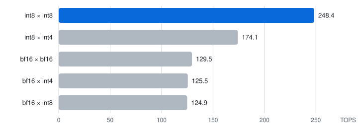

# DeepSeek-V4.1-Flash-1017 on one M5 Ultra

DeepSeek-V4.1-Flash-1017 served on a single 256 GB Mac Studio (M5 Ultra) by TensorFold's native Metal engine.

- **Context:** the full 1,048,576-token window.
- **Features:** DSpark drafts, the prompt cache, images, tools and structured output.
- **Checkpoint:** [`BobClawblaw/DeepSeek-V4.1-Flash-1017-TensorFold-e2e3-p4-h8`](https://huggingface.co/BobClawblaw/DeepSeek-V4.1-Flash-1017-TensorFold-e2e3-p4-h8), 418 GB.
- **Engine:** the `deepseek-v41-main` branch of [BobClawblaw/TensorFold](https://github.com/BobClawblaw/TensorFold/tree/deepseek-v41-main), pinned at `72a552ed`.

The engine is not part of upstream TensorFold. The DeepSeek family upstream is being coordinated on
[ashhart/TensorFold#847](https://github.com/ashhart/TensorFold/issues/847).

## Results

Measured on one M5 Ultra (80-core GPU, 256 GB), macOS 27.0.1. Speed comes from
[recipe-harness](https://github.com/BobClawblaw/recipe-harness), target `deepseek-v41-m5`; its `stats/` has every run.

- **Engine for these runs:** each table names its engine and run. The prompt numbers and the thinking-off quality run
  are on `72a552ed` and the 1M run on `04c41884`; decode and several streams are on `8557236a`, whose decode path the
  later builds keep. The first builds, `6a4d7be7`, were reworded and rebased onto TensorFold 1.1.0 as `269f2447`, with
  the same DeepSeek code.
- **`7837387a`** adds the thinking reserve (below) to the server and the lanes; the forward is unchanged.
- **`f8a3ce2f`** adds a guard for reasoning that repeats a long passage verbatim (below); replies that don't loop are
  unchanged.
- **`c4c69219`** adds shared rounds for up to four streams and prompts a chunk between their rounds (Several streams,
  below). A lone stream's logits are byte-identical to `7837387a`'s on the same four prompts.
- **The rebase was checked:** its logits are byte-identical to the pre-rebase build on four prompts (chunks of 1,024
  and of 256, draft windows of 6, one row at a time).
- **`bfad20ae`** makes prompts faster (Prompts, below): a lone stream's prompt goes in chunks of 3,968 rows (1,024
  beside other streams), the next chunk's engram rows are gathered on the CPU while the GPU runs this one, and a
  chunk's index scores run on the tensor units. Logits are bit-identical to `f8a3ce2f` on a 1,500-token prompt and an
  8,192-token random one, in chunks of 1,024 and of 3,968; decode is unchanged.
- **`c14c1848`** merges upstream TensorFold 1.1.1 (93 commits). Upstream now carries its own CUDA DeepSeek-V4.1 family
  under `families/deepseek_v41`, so this Metal family lives in `families/deepseek_v41_metal`; its registry entry
  declares no raw-text mode, which sends the community-v2 benchmark's code prompt through chat (Known limits, below).
  Logits are bit-identical to `98e41cae` on the same 1,500-token and 8,192-token prompts. From upstream: a sampled
  request without a `seed` draws its own (the completion line records it; a given `seed` still repeats), `--api-key`
  and `--api-key-file`, and Host and Origin checks that apply only to a loopback bind, so the recipe's `0.0.0.0`
  listener answers the LAN as before. The served build reports version 1.1.1.
- **`8557236a`** puts a window's dense projections (the attention projections, the shared expert, the head; rows under
  16) on the core's 8-row simdgroup-matrix tiles, with the core's scalar twin at 1 and 2 rows. The row kernel read a
  weight once a pair of rows and grew with the window: 1.9 ms of attention projections a step at one row, 4.7 at six;
  the tiles read it once and stay flat. The server's measured window costs went from 14.8 / 19.7 / 29.5 / 39.4 ms at
  1 / 2 / 4 / 6 rows to 15.1 / 19.8 / 27.1 / 33.9, and four streams' shared rounds from 54.5 / 91.9 / 131.3 ms at
  8 / 16 / 24 rows to 45.2 / 73.3 / 106.2, so the depth policy drafts deeper (Decode and Several streams, below).
  A prompt chunk keeps the tensor units, so prompt logits are bit-identical to `c14c1848`; a window's logits change
  with the tiles' reduction order, the same at every window width (a 6-row window equals one row at a time on 8,192
  rows, drafted equals plain on 64 of 64 tokens, four shared streams equal each alone on 108 of 108 rows). The twin
  is checked against the tiles at load on the first layer's dense shapes and the head; a difference would keep the
  row kernels.
- **`aee8036c`** decodes WebP images through the core's libwebp decoder (Homebrew's libwebp 1.6.0), as the server's
  refusal text had promised; GIF stays refused with a clear 400. Through the served API: lossy and lossless WebP,
  PNG and JPEG answered, GIF refused; spot checks 12 of 12. Against the study's fp4 replies (`tools/native_kl.py`, 190 teacher-forced tokens over three prompts) the tiles give
  KL 0.167 and top-1 0.889, the row kernels 0.164 and 0.893 (code 0.065 / 0.969 against 0.063 / 0.953, math 0.128 /
  0.859 against 0.134 / 0.859, zh 0.333 / 0.823 against 0.320 / 0.855).
- **`845ccbd8`** makes a prompt chunk's experts, router and stream mixing faster. The routed slots are sorted by expert
  in three parallel passes instead of on one GPU thread (about 180 ms to 2.5 ms a chunk); the experts' gate and up
  projections and DeepSeek's route-weighted SwiGLU run as one kernel, with no sorted copy of the rows; the stream mixing
  between layers takes four rows a threadgroup; the router reads each input once for four outputs.
- **`4f0c5e5e`** makes the indexer faster at depth. Index scores are kept as bf16 (they were already rounded to bf16)
  and their top-k takes two radix passes instead of four; the kept-candidate scores read each query once for a block of
  8 keys; the draft head's scratch no longer holds index scores, so the prompt's score buffer grows from 256 MB to
  768 MB with 64 MB less in all, and a chunk at 1M takes 384-row slices instead of 64.
- **`04c41884`** gives a lone stream's prompt the wide chunks `bfad20ae` meant it to have. Chat requests carry chunk
  starts every 1,024 tokens (the prompt cache's save points) and each chunk was cut at the first, so every served
  prompt went in 1,024-row chunks; a lone stream's chunk now runs on to the last start it reaches (3,072 rows). Beside
  other streams, and at save marks, chunks are cut as before.
- **These three were checked:** logits are byte-identical to `aee8036c` on the 1,500-token and 8,192-token prompts (in
  chunks of 1,024 and 3,968); four shared streams equal each alone (420 of 420 rows, 120 of 120 drafts); drafted equals
  plain on 64 of 64 tokens; decode is unchanged. Through the served API, `04c41884`'s greedy replies equal the
  1,024-row build's on a fresh 10,776-token prompt, a 37,308-token one and a turn resumed from the prompt cache. In the
  engine's depth profile (`tf-dsv41-forward DS_DEPTH`, a lone 3,968-row chunk) the chunk went from 1,548 to 1,779 tok/s
  at depth 0 and from 854 to 1,132 at 1M (`aee8036c` to `4f0c5e5e`). A spot check through the served API on `04c41884`
  passed: a data-URL image, a `get_weather` call, a `json_schema` reply and a drafted reply equal to its plain one.
- **`72a552ed`** runs a prompt chunk's routed experts as int8 x int8 on the tensor units, which multiply int8 at about
  twice the rate of bf16 (The GPU's matrix units, below). Each chunk's expert inputs are rounded to int8 with one fp32
  scale a 32 columns, the 2- and 3-bit codes go into the tile as int8 instead of bf16, and the sums are int32. The
  weights in memory are unchanged; two scratch buffers add 62 MB. Decode (one row, or a draft window, at a time) keeps
  bf16. In the depth profile a 3,968-row chunk goes from 1,772 to 1,825 tok/s at depth 0 and from 1,115 to 1,140 at 1M
  (bf16 is still there for the check program, `DS_BF16=1`, whose logits are byte-identical to `04c41884`'s); through the
  server the prompts are from 1% slower to 2% faster than `04c41884`'s (below). A prompt's logits change: KL 0.018
  against bf16 on the 1,500-token prompt, where bf16's own prompt path and its one-row-at-a-time path differ by 0.019.
  Four shared streams equal each alone (5,880 of 5,880 rows, 1,680 of 1,680 drafts), drafted equals plain on 64 of 64
  tokens, and through the served API a data-URL image, a `get_weather` call, a `json_schema` reply and a drafted reply
  equal to its plain one pass. The thinking-off quality run (Quality, below) is inside the bf16 runs' range on every
  check but MATH-500, where it scores above them; the thinking-on run was not repeated. The harness runs and the served
  checks ran on `5babc696`, which differs from `72a552ed` in three comments only.

### Decode, one stream

Harness speed plan, run `20261020-091934-dsv41-speed` on `8557236a`. Drafts on, thinking off, greedy, short prompts.

| Prose | Code | Structured | List | First token |
|---|---|---|---|---|
| 70.7 tok/s | 104.9 tok/s | 87.6 tok/s | 103.8 tok/s | 0.10–0.14 s |

At 1M deep, a follow-up turn on a 1,007,442-token conversation decoded 197 tokens at 46.3 tok/s, drafts on. That
is one sample from a script, not the harness.

### Prompts, cold

Harness prefill plan: run `20261020-091454-prefill` on `8557236a` (the prompt path `aee8036c` kept) against run
`20261023-021006-prefill` on `72a552ed`. One fresh prompt per size, timed to the first token (with thinking on, the
first reasoning token); tok/s.

| Prompt tokens | Thinking off, old | Thinking off, now | Thinking on, old | Thinking on, now |
|---|---|---|---|---|
| ~2k | 1,222 | 656 (cold, below) | 1,366 | 1,614 (+18%) |
| ~8k | 1,451 | 1,739 (+20%) | 1,445 | 1,867 (+29%) |
| ~33k | 1,422 | 1,829 (+29%) | 1,424 | 1,807 (+27%) |
| ~131k | 1,380 | 1,793 (+30%) | 1,378 | 1,769 (+28%) |
| ~1M | 565 (`6a4d7be7`, 1,783.5 s) | 1,386 (`04c41884`, 740.0 s) | | |

Each run's ~2k thinking-off prompt is its first request after the server loads, and its first chunk waits on the engram
table: 189 GB that stays on the SSD (memory-mapped beside ~200 GB of weights). A prompt's later chunks have their rows
read while the GPU runs the chunk before; the first has nothing to hide behind, and after a load its rows are cold, by
how much depending on what the page cache still holds. So the harness's first cell varies run to run (1,222 on
`8557236a`, 1,337 on `4f0c5e5e`, 759 on `04c41884`, 656 on `72a552ed`). Measured by a script (not the harness), each
server freshly loaded and sent one fresh ~2k thinking-off prompt, then warm ones: `4f0c5e5e` 3.47 and 2.76 s cold, then
1.41-1.43 s; `04c41884` 2.81, 3.15 and 3.35 s cold, then 1.41-1.49 s (1,389-1,488 tok/s, against the old engine's
1,222). The cold cost is the same on both: 1.3-2.1 s more on the first request after a load.

Runs in between, thinking off (~2k / ~8k / ~33k / ~131k): `04c41884` 759 / 1,718 / 1,806 / 1,772 and thinking on 1,598 /
1,837 / 1,826 / 1,772 (`20261022-205404-prefill`), so through the server int8 is from 1% slower to 2% faster than bf16;
`4f0c5e5e` 1,337 / 1,642 / 1,654 / 1,608 (`20261022-201421-prefill`), `845ccbd8` 1,334 / 1,614 / 1,581 / 1,525
(`20261022-162728-prefill`); before them `6a4d7be7` 1,093 / 1,240 / 1,256 / 1,195 (`20261018-183907-prefill`).

A 1,025,994-token prompt (numbered lines of words, a passphrase 37% of the way in, asked for at the end; thinking off)
reached its first token in 740.0 s through the server on `04c41884`, 1,386 tok/s on average, and the reply was the
passphrase. On `4f0c5e5e` the same kind of prompt took 836.5 s, and on `6a4d7be7` a 1,007,409-token prompt took
1,783.5 s (565 tok/s). In the engine's depth profile a lone 3,968-row chunk at 1M depth runs at 1,132 tok/s
(`4f0c5e5e`; 854 on `8557236a`, 402 on `6a4d7be7`).

### The GPU's matrix units



Peak throughput of the M5 Ultra's tensor units by operand type (inputs x weights), in tera-operations a second, from
[`tools/mmbench`](tools/mmbench): one 16x32x512 cooperative-tensor matmul repeated 512 times in each of 2,048
threadgroups, the best of four dispatches. Each bar is the best of four runs (2026-10-22 and 23); the runs varied by up
to 6%. Only int8 x int8 beats bf16, by about twice. bf16 inputs on int8 or int4 weights run at the bf16 rate, int4 is
taken only as the weights (int4 inputs are refused as an unsupported type), and the Metal compiler has no 2-bit,
3-bit, fp8 or fp4 operands. The checkpoint's 2- and 3-bit codes stay packed in memory and are widened in each tile
just before the multiply, to bf16 before `72a552ed` and to int8 since.

### Several streams

Up to four streams decode together: their windows go through one forward, each stream's attention on its own rows.
Every shared forward uses the row kernels a stream uses alone, so each reply is the same as it would be alone. Each
row still reads its own routed experts, which limits the gain. Measured with the recipe harness (run
`20261020-091934-dsv41-speed`, engine `8557236a`, 256-token replies), in tok/s summed over the streams by wall clock:

| Streams | Prose | Code | Structured | List | First token |
|---|---|---|---|---|---|
| 1 | 70.7 | 104.9 | 87.6 | 103.8 | 0.10-0.14 s |
| 2 | 96.6 | 111.6 | 106.9 | 150.4 | 0.21-0.29 s |
| 4 | 126.8 | 138.5 | 132.5 | 146.4 | 0.43-0.58 s |

On `c14c1848`, with the row kernels, one stream gave 68.8 / 87.7 / 82.1 / 94.5 and four 107.1 / 119.3 / 115.5 / 122.1.

On `c4c69219` (run `20261019-090829-dsv41-speed`) four streams gave 93.5 / 101.4 / 89.8 / 102.1.

A lone stream's prompt goes in 3,968 tokens at a time. Beside other streams it goes in 1,024 at a time, with the other
streams decoding between chunks for half the time: on `c4c69219`, a 60k-token prompt took 54.2 s while another reply
decoded, against 43.0 s alone, and during it 18 chunks took 14.6 s and the reply decoded in the 14.6 s between them.

The streams share `context`: each holds its prompt plus its `max_tokens` (and, with thinking on, the reserve). A
request that would pass it waits until a stream ends, and the requests queued behind it wait in order.

## What works, and how it was checked

Each row below was checked through the server's chat API on engine `269f2447`, apart from the harness checks, the 1M run and the check program noted, which ran on the same code before the rebase. On `c14c1848`, again on `8557236a` and, without the `seed` and `Host` checks, on `04c41884` a spot check through the served API passed: a repeated `seed` at temperature 1 repeats its reply and no seed draws fresh ones, thinking on and off, a `get_weather` call, a `json_schema` reply, a data-URL image, a drafted reply equal to its plain one, and a LAN `Host` header.

| Feature | Check |
|---|---|
| Greedy and sampled text | The ruler's prose, code, structured and list replies; the same seed at temperature 1 gives the same reply twice |
| Thinking | On by default; `chat_template_kwargs: {"enable_thinking": false}` turns it off; the reasoning comes back in `reasoning_content` |
| Thinking reserve | On `7837387a`, thinking on: with `max_tokens` 8 and 40, a 2,095-token reasoning was followed by answers of exactly 8 and 40 tokens; thinking off stopped at exactly 8 and 40; drafted equals `"draft": false` |
| Loop guard | On `f8a3ce2f` with the 48k reserve: GPQA-Diamond questions 8 and 10, which had reasoned to the limit without answering, closed at repeated passages of 5,352 and 2,996 tokens and answered. Question 10 gives the same reply drafted and with `"draft": false` (sha `1fd5b84a8c20`). Seven GSM8K thinking replies are the same with the guard as without |
| Long context | A passphrase planted 37% of the way into a 1,007,409-token prompt was recalled exactly |
| Tools | A `get_weather` call comes back as `tool_calls` with the right arguments, with thinking on and with it off |
| Structured output | A `json_schema` reply parses and fits its schema |
| Images | A pasted photo of carrots is answered "Carrot"; with `vision_urls` on, a public HTTPS image is described correctly, and loopback, LAN and plain-HTTP URLs are refused with a 400. On `aee8036c`: PNG, JPEG, WebP (lossy and lossless) and PNG with alpha as data URLs, text in an image read exactly, three circles counted, a 3000x2000 JPEG, four images in order, a fifth and a corrupt one refused with clear 400s, a 20k-token turn with an image resumed from the prompt cache next turn, two image requests at once |
| Drafts | Drafted replies equal `"draft": false` replies (4 of 4); with the check program, a 268-token greedy reply drafted equals it plain |
| Prompt cache | The harness `turns` check (again on `72a552ed`, run `20261023-021357-speed`): a resumed third turn equals the same turn sent cold after a restart, with 4,541 of 4,561 tokens cached; a 1M conversation resumes in 7.8 s |
| Concurrency | On `c4c69219` at `--parallel 4`: four requests at once (one sampled with a seed) each equal the same request alone; a reply decoding while a 60k-token prompt went in equals it alone; with `context` 20,000, a second ~12k-token request waited for the first and both finished |

Notes on these checks:
- **Images:** `image_url` parts, pasted as data URLs (base64): PNG, JPEG or WebP (lossy and lossless); GIF is refused
  with a 400. One image takes at most 1,024 tokens, a request at most 4,096 image tokens (`vision_image_tokens`), and
  at most 4 images (`vision_max_images`).
- **Image links:** `vision_urls = true` also lets the server fetch public HTTPS images. Every address and redirect must
  be public, there are at most 3 redirects, and fetches time out after 10 s each and 30 s a request. It is off by
  default, so a server on a LAN fetches nothing on its callers' behalf.
- **Drafts with the check program:** that check ran on `544b3a40`, whose decode path the current engine keeps.

## Quality

- **Against DeepSeek's own fp4 weights:** KL 0.138 and top-1 agreement 0.909, teacher-forced on four prompts of 64
  tokens each (`tools/native_kl.py`, a row a step). Measured on engine `fcf9e0b4`; the current engine keeps that
  decode arithmetic.
- **Against the reference in FP64** (DeepSeek's `model.py` over this checkpoint's own codes; runners in
  [this gist](https://gist.github.com/BobClawblaw/5e120cb3f7a7b3c9d7ca9b40ebea29f0)):
  - **Eight tokens:** the engine is 8.08% NRMS from FP64, against 4.22% between the FP32 and FP64 references, with
    the top token right at 8 of 8.
  - **A 268-token greedy reply:** the engine's tokens are FP64's top token at 252 of 268 positions; FP32's agree at 250.
  - Details are on [#847](https://github.com/ashhart/TensorFold/issues/847#issuecomment-6256853391).
- **The harness quality suite:** the [GLM-5.3 recipe's](https://github.com/BobClawblaw/glm53-flash-exl3-2x-dgx-sparks)
  suite through recipe-harness, served at 1M context, greedy.
  - **Thinking off:** run `20261023-021709-dsv41-quality-off`, engine `72a552ed` (int8 experts in prompt chunks). The
    bf16 runs on `8557236a` (the tiles), `bfad20ae` (the prompt-speed commit, row kernels) and `269f2447` are in the
    notes.
  - **Thinking on:** run `20261019-034805-dsv41-thinking`, engine `7837387a` with a 32,768-token reserve, two requests
    at a time. It was not repeated on `72a552ed`.
  - A lone stream's logits are byte-identical on `269f2447`, `7837387a`, `bfad20ae`, `c4c69219` and `c14c1848`. On
    `8557236a` a prompt's logits are the same and a window's differ (the tiles, above); on `72a552ed` a prompt's
    differ (int8, above) and a window's are `8557236a`'s.

| Check | Thinking off | Thinking on |
|---|---|---|
| GSM8K (first 250) | 246/250 (98.4%) | 243/250 (97.2%) |
| MATH-500, the suite's fixed grader | 468/500 (93.6%) | at least 469/500 |
| MATH-500, as the runs graded it | the same (this run used the fixed grader) | 451/500 (90.2%) |
| MGSM (8 languages, 30 each) | 218/240 (90.8%) | not run |
| MMLU (342 questions) | 307/342 (89.8%) | not run |
| IFEval (150 prompts) | 129/150 loose, 122/150 strict | not run |
| Tools | 58/60 | not run |
| Structured output | 30/30 | not run |
| GPQA-Diamond | not run | not run |
| The harness's thinking problems | — | 10/10, all with `reasoning_content` |

Notes on the table:
- **MATH-500's grader** rejected some correct answers: units after a number, `{,}` separators, set braces, lists in
  another order, and (a bug) matrices written with spaces. It was fixed on 2026-10-19 (the suite's `277c842`). The
  thinking-on run was regraded from the answers it kept; it kept only its first 40 misses, hence "at least". The
  thinking-off runs of 2026-10-20 used the fixed grader from the start. Most of what is still marked wrong with
  thinking on is the same value written another way, plus four replies with no boxed answer. With thinking off it is
  mostly wrong values plus 12 with no boxed answer (20 on `8557236a`). The details are in
  [recipe-harness's README](https://github.com/BobClawblaw/recipe-harness#reading-quality-scores-the-graders-limits).
- **Earlier thinking-off runs, all bf16:** on `8557236a` (the tiles, 2026-10-20) GSM8K 245/250, MATH-500 459/500,
  MGSM 219/240, MMLU 303/342, IFEval 132/150 loose and 125/150 strict, tools 58/60; on `bfad20ae` (row kernels,
  2026-10-20) GSM8K 246/250, MATH-500 462/500, MGSM 217/240, MMLU 306/342, IFEval 130/150 loose and 124/150 strict,
  tools 57/60; on `269f2447` (2026-10-18) GSM8K 247/250, MATH-500 457/500 as graded then (at least 465 regraded),
  MGSM 217/240, MMLU 307/342, IFEval 129/150 loose and 122/150 strict, tools 58/60. The tiles run is within three
  questions of the other two on every check, up on some and down on others, as a reduction-order change should be
  (the KL check above). The int8 run on `72a552ed` is inside the bf16 runs' range on every check except MATH-500,
  where it is above them (468 against 459 and 462 with the fixed grader, and at least 465 regraded); its IFEval
  matches the lowest.
- **GSM8K with thinking on** misses two problems that thinking off gets right. Each turns on ambiguous wording read
  another way than the answer key. For example, it reads "two times older" as 1 + 2 x 1, and answers "how much more
  likely, as a percentage" with the relative difference rather than percentage points. The other five misses are
  the same in both modes.
- **MATH-500 by level,** thinking off (the fixed grader): L1 43/43, L2 90/90, L3 99/105, L4 117/128, L5 119/134
  (on `8557236a`: L3 97, L5 112).
  Thinking on (as the run graded it): L1 41/43, L2 79/90, L3 96/105, L4 113/128, L5 122/134.
- **GPQA-Diamond was not run to the end.** With thinking on and greedy decoding, two of its first twenty questions
  reasoned in a loop and never answered. Question 8 repeats the same passage about the molecule's symmetry from 38%
  of the way in. Both used all 36,864 tokens of the 32k reserve and, asked again, all 53,248 of the 48k one.
  The loop guard on `f8a3ce2f` now closes such a loop, after which the model answers. Both questions then answered,
  wrongly.
- **Tools:** both misses are right calls with one optional argument more than the checker expects (an empty
  `folder`, a `label`).
- **Behaviour and drafts:** streaming, multi-turn recall, stop strings, thinking split, exact copy, `max_tokens` and
  12 drafted-vs-plain replies all pass.
- **IFEval with thinking on** is not in the table: the suite always sends IFEval with thinking off.

## Requirements

- **Hardware:** a Mac with 256 GB of unified memory. The weights take about 200 GiB; the Engram tables (189 GiB) are
  read from disk where lookups land.
- **Chip:** measured on an M5 Ultra, where prompt chunks use the GPU's tensor units. Older chips take the plain
  kernels with `zig_cpu = "apple_m1"`; not measured.
- **Software:**
  - [Zig 0.17.0](https://ziglang.org/download/) for the engine
  - Python 3.11 or newer
  - `cmake` (for libjpeg-turbo)
  - `git`
  - the `hf` CLI to download the checkpoint
- **Disk:** about 420 GB for the checkpoint, plus the engine build.

## Running it

```sh
git clone https://github.com/BobClawblaw/deepseek-v41-flash-mlx-m5-ultra && cd deepseek-v41-flash-mlx-m5-ultra
git clone -b deepseek-v41-main https://github.com/BobClawblaw/TensorFold ~/github/TensorFold
hf download BobClawblaw/DeepSeek-V4.1-Flash-1017-TensorFold-e2e3-p4-h8 \
    --local-dir ~/models/DeepSeek-V4.1-Flash-1017-TF-mix23-d8b4
cp local.example.toml local.toml      # this Mac's overrides; edit paths and the port there
python3 -m mac validate               # settings, checkpoint and build, without starting anything
python3 -m mac up                     # builds the pinned engine, libjpeg-turbo and libtfgrammar once, then serves
```

The server speaks the OpenAI API at `http://127.0.0.1:8890/v1`, model `DeepSeek-V4.1-Flash`. Other commands:

| Command | What it does |
|---|---|
| `python3 -m mac status` | the server's pid, URL and health |
| `python3 -m mac logs` | the server log's last lines |
| `python3 -m mac chat "..."` | one prompt to the running server |
| `python3 -m mac down` | stops the server |
| `python3 -m mac command` | prints the serve command `up` runs |

**Running at login:** `python3 -m mac launchd --port 8888` writes a launchd unit that serves the LAN at login. Loading
it is up to you:

```sh
launchctl bootstrap gui/$(id -u) ~/Library/LaunchAgents/com.tensorfold.deepseek-v41.plist
```

That unit is kept alive: a killed server restarts 30 s later. Stop it with `launchctl bootout` before running anything
else that loads the model, since two copies do not fit in 256 GB.

**Converting from the release instead of downloading:** with `deepseek-ai/DeepSeek-V4.1-Flash-1017` at `1bae0e10` in
the Hugging Face cache, run `python3 -m mac convert`, then `python3 tools/split_engram.py MODEL_DIR` to split the
Engram tables as the Hub copy is.

## Settings

All of these are in `recipe.toml`'s `[serve]`. `local.toml` overrides them, and so does an environment variable of
the same name in upper case.

| Key | Default | Meaning |
|---|---|---|
| `context` | 524288 | Positions the streams hold together; the model's window is 1,048,576 |
| `parallel` | 4 | Streams at once, their windows in one forward |
| `drafts` | true | The checkpoint's DSpark head drafts; replies equal undrafted ones |
| `thinking` | true | Thinking on unless a request turns it off |
| `prompt_cache_gib` | 6 | Memory for kept prompt states, used past the engine's 70% share (`prompt_cache_over_cap`) |
| `vision`, `vision_image_tokens`, `vision_max_images` | true, 4096, 4 | Image input and its limits |
| `vision_urls` | false | Also fetch public HTTPS image URLs (data URLs work either way) |
| `max_tokens`, `temperature` | 32768, 0 | A request's defaults |
| `loop_guard` | true | With thinking on, close the reasoning once it repeats itself verbatim: a cycle of up to 8 tokens held for 256, or a passage repeated in full and for at least 1,024 tokens. The model then answers |
| `thinking_reserve` | 49152 | With thinking on, reasoning tokens a reply may use beyond its `max_tokens`, which then limits the answer after the reasoning |
| `memory_margin_gib` | 6 | `up` refuses to start when free memory is under the weights plus this |

**For the full window,** set `context = 1048576` (see `local.example.toml`). Measured at `parallel = 1`, the server
held 202.4 GiB once loaded, and at least 19.5 GiB stayed free through a 1,007,409-token prompt. Since the streams share
`context`, more streams don't raise that peak.

## Known limits

- **Four streams give 1.3-1.8x one stream's throughput,** not 4x. Each row reads its own routed experts.
- **No leaderboard entry yet.** TensorFold's community-v1 `code` prompt is a raw completion with no template, and at
  temperature 1 this checkpoint ends it early on three of the five fixed seeds (after 50, 34 and 196 tokens), so a v1
  receipt is incomplete and the harness publishes nothing
  ([ashhart/TensorFold#1019](https://github.com/ashhart/TensorFold/issues/1019)). Since `c14c1848` the family declares
  itself chat-only and the community-v2 protocol sends that prompt through chat: a local v2 run on the public
  `e2e3-p4-h8` checkpoint completed all four cells (code 88.7 and 95.2 tok/s at temperature 1 and 0, chat 70.7 and 71.5,
  first text 0.11-0.12 s), but TensorFold 1.1.1 refuses to publish v2 receipts until the board accepts them.
- **Not yet upstream:** the DeepSeek kernels are not registered with TensorFold's kernel contract.

## Layout

| Path | What it holds |
|---|---|
| `mac/` | `python3 -m mac`: settings, the engine build, the server, the launchd unit |
| `template/` | The chat template (renders byte for byte like DeepSeek's `encoding/encoding.py`) and its checks |
| `tools/` | The converter, the Engram split, the KL check against the fp4 release, `mmbench` (the matrix-unit benchmark) |
| `docs/` | The matrix-unit chart |
| `ref/` | A CPU reference: DeepSeek's `model.py` and `engram.py` (MIT, `LICENSE.deepseek`), torch kernels, the loader, the whole-model gate |
| `PLAN.md` | The work log, with how each number was measured |

## License

MIT (`LICENSE`). DeepSeek's `model.py`, `engram.py`, `image_processor.py` and the encoding under `ref/` keep their own
MIT license and copyright (`ref/LICENSE.deepseek`).
